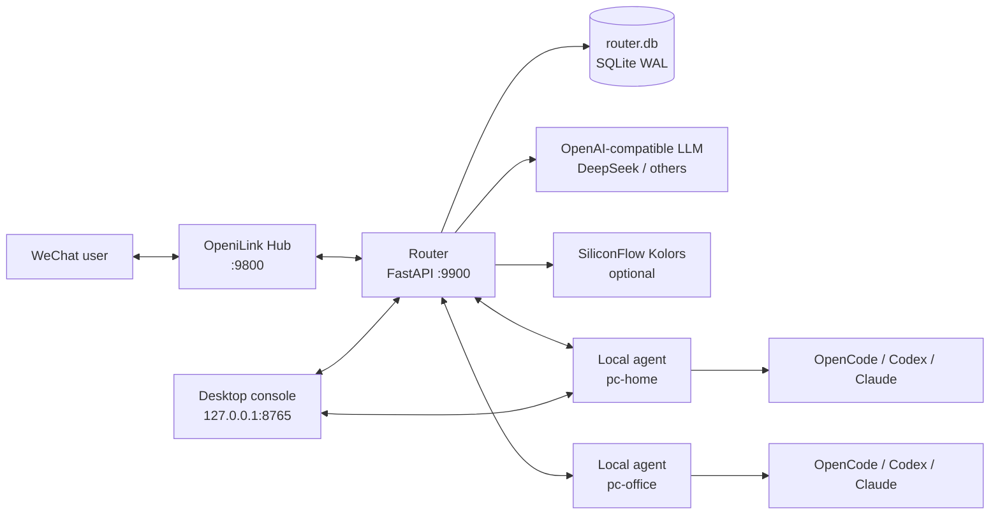
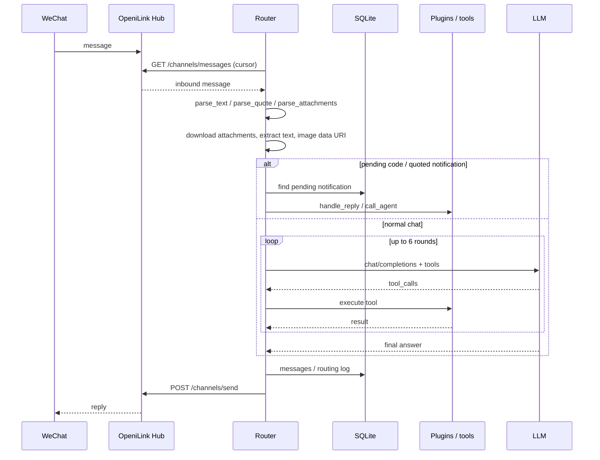
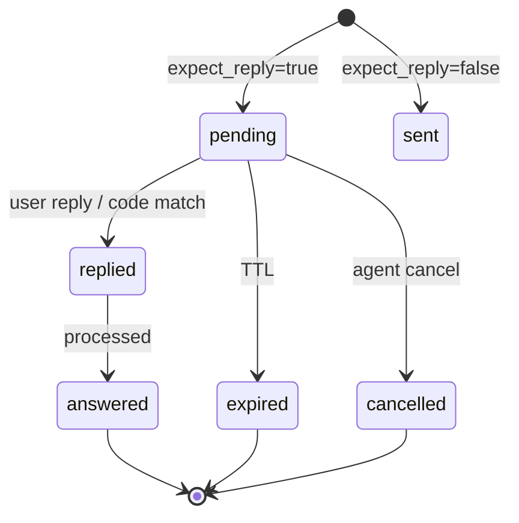

<div align="center">


# 微桥 · WeChat Agent Router

**Turn WeChat into a remote control for AI agents on multiple computers.**

[简体中文](README.md) · [English](README.en.md)

Send one message in WeChat and let OpenCode at home, Codex at the office, or Claude Code on your laptop do the work.  
File changes require an approval code. Images are understood directly. Drawings are generated and sent back.

[](https://www.python.org/)
[](https://fastapi.tiangolo.com/)
[](https://www.docker.com/)
[](https://github.com/Wing233/wechat-agent-router/pkgs/container/wechat-agent-router)
[](https://github.com/Wing233/wechat-agent-router/actions/workflows/ci.yml)
[](LICENSE)
[](#contributing)

[Quick start](#quick-start) · [Architecture](#architecture) · [Plugins](#plugin-system) · [Configuration](#configuration) · [API](#api-reference) · [Security](#security-model)

</div>

<div align="center">
  
  <br />
  <sub>File approval flow (demo data)</sub>
</div>

---

## Table of contents

- [What is this](#what-is-this)
- [Why](#why)
- [Features](#features)
- [Screenshots](#screenshots)
- [Architecture](#architecture)
- [Message flow](#message-flow)
- [Built-in plugins](#built-in-plugins)
- [Quick start](#quick-start)
- [Local agent](#local-agent)
- [Desktop console](#desktop-console)
- [Configuration](#configuration)
- [API reference](#api-reference)
- [Plugin development](#plugin-system)
- [Security model](#security-model)
- [Operations](#operations)
- [FAQ](#faq)
- [Roadmap](#roadmap)
- [Contributing](#contributing)
- [License](#license)
- [Related projects](#related-projects)
- [Acknowledgements](#acknowledgements)

---

## What is this

微桥 is a **self-hosted WeChat AI agent gateway**.

It does not speak the WeChat protocol directly. It uses [OpeniLink Hub](https://github.com/openilink/openilink-hub) as the transport, and keeps routing, tools, approvals, schedules, and state in its own Router.

```text
WeChat  →  OpeniLink Hub  →  Router  →  LLM / plugins / local agents
                              ↑
                    desktop console / SQLite / scheduler
```

Typical use cases:

- Command OpenCode / Codex / Claude Code on your home PC from WeChat
- Add your own APIs, databases, files, reminders, and todos to a WeChat bot
- Let the bot read images, PDFs, and Word documents, then reply in WeChat
- Generate images with a text-to-image model and send them back
- Require human approval before file changes or plugin installation
- Manage multiple computers and agents from one place

---

## Why

Most WeChat bots only chat. Most local agents only work when you sit in front of the computer.

微桥 connects them:

| Problem | What 微桥 does |
|---|---|
| WeChat bots cannot do real work | Dispatch tasks to local CLIs through an agent protocol |
| Home PCs are behind NAT | Local agents poll outbound; no inbound port |
| Letting AI edit files is scary | 4-character approval code before write/delete/move |
| Every feature requires core changes | Manifest + permission + hot-reload plugin system |
| Multiple computers are confusing | One `agent_id` per machine; route by description or `@id` |
| Images/PDFs are opaque | Vision model for images; text extraction for PDF/DOCX |
| "Draw me a picture" returns ASCII | SiliconFlow Kolors generates and sends an image |
| Scheduled jobs are scattered | SQLite-backed jobs and reminders survive restarts |

---

## Features

<table>
<tr>
<td width="50%" valign="top">

**WeChat & messaging**

- Text chat, quoted replies, 4-character approval codes
- Image understanding (vision model)
- File reading: txt / md / csv / json / pdf / docx
- Outbound images, videos, and files
- Notification states: pending / replied / answered / expired
- Outbox retry on send failure

</td>
<td width="50%" valign="top">

**Agents & tools**

- Outbound-polling local agents (NAT friendly)
- Engines: OpenCode / Codex / Claude Code / any command
- Workspace aliases + path allowlist
- 6-round tool loop with duplicate-call detection
- Plugin hot reload, enable, disable
- Approval-gated file operations + path sandbox

</td>
</tr>
<tr>
<td valign="top">

**Automation**

- One-shot / interval / cron reminders
- Persistent scheduled jobs; missed windows are skipped
- Todo list with optional due reminders
- DeepSeek balance query
- Custom data plugins via the plugin API

</td>
<td valign="top">

**Generation & multimodal**

- SiliconFlow Kolors text-to-image
- Generated images are sent to WeChat automatically
- Size/count limits for inbound attachments
- Attachments saved to `/workspace/inbox`
- Generated images saved to `/workspace/generated`

</td>
</tr>
</table>

---

## Screenshots

The desktop console is the visual configuration surface for the local agent and the remote Router.

### Overview


### Plugins


> Screenshots use demo data. All addresses are `example.com`.

---

## Architecture

### Deployment topology



### Modules

| Module | Responsibility |
|---|---|
| `app.py` | Composition root: config, Hub polling, routing, LLM tool loop, notifications, jobs, internal API |
| `hub.py` | OpeniLink Hub client: text/file send, message polling, media download, quote/attachment parsing |
| `llm.py` | OpenAI-compatible Chat Completions client with tools and vision |
| `store.py` | SQLite state: notifications, messages, outbox, credentials, reminders, plugin audit |
| `plugin_loader.py` | Manifest validation, permissions, tools/jobs/services/secrets, hot reload |
| `registry.py` | Tool registry and job scheduler |
| `settings_service.py` | Runtime settings: job intervals, plugin enable/disable, agent CRUD, masked config |
| `agent_broker.py` | In-memory task queue for outbound-polling agents |
| `attachments.py` | Inbound attachment download, storage, image data URI, PDF/DOCX text extraction |
| `imagegen.py` | SiliconFlow Kolors text-to-image client |
| `desktop/` | Windows desktop console (PyWebView + native HTML/CSS/JS) |
| `local-agent/` | Local agent runtime and CLI entry |
| `plugins/` | Business plugins: one manifest + implementation per directory |

---

## Message flow

### Inbound message



### Local agent task

```mermaid
sequenceDiagram
    participant R as Router
    participant B as AgentBroker
    participant A as Local agent
    participant CLI as Local CLI

    R->>B: enqueue(task, wait_seconds)
    A->>R: POST /agent/register
    A->>R: GET /agent/tasks
    R->>B: take()
    B-->>A: task payload
    A->>CLI: execute (message appended as last arg)
    CLI-->>A: stdout / exit code
    A->>R: POST /agent/result
    R->>B: complete(task_id)
    B-->>R: wake waiter
    R-->>User: reply
    Note over A,R: after timeout, reply "task received"; send /v1/notify when done
```

### Approval state machine



---

## Built-in plugins

| Plugin | Capability | Main tools |
|---|---|---|
| `admin` | Introspection & config | `list_jobs` `get_job` `set_job_interval` `set_job_enabled` `list_plugins` `config_get` `config_set` `api_balance` |
| `agents` | Agent routing | `send_to_agent` |
| `reminders` | Reminders | `create_reminder` `list_reminders` `cancel_reminder` `pause_reminder` `resume_reminder` `snooze_reminder` |
| `todo` | Todo list | `todo_add` `todo_list` `todo_update` `todo_done` `todo_delete` `todo_clear_done` |
| `ops` | File operations | `fs_list` `fs_read` `fs_write` `fs_replace` `fs_delete` `fs_move` |
| `leetcode` | LeetCode (disabled by default) | `leetcode_stats` + cookie validation + login page |
| `deepseek_balance` | Balance query | `deepseek_balance` |
| `evolution` | Self-evolution (disabled by default) | `propose_plugin` |
| `demo_time` | Time demo | `now` |
| `demo_weather` | Weather demo | `now` |

Core tools:

| Tool | Description |
|---|---|
| `send_media` | Send an image, video, or file from `/workspace` or `/data/images` to WeChat |
| `generate_image` | Generate an image with SiliconFlow Kolors and send it |

> `leetcode` and `evolution` are disabled in the example config: one involves third-party platform ToS, the other can generate and install code. Read the [security model](#security-model) before enabling them.

---

## Quick start

### Prerequisites

- A Linux server (or a NAS / cloud host that can run Docker)
- [OpeniLink Hub](https://github.com/openilink/openilink-hub) deployed and bound to WeChat
- An OpenAI-compatible LLM API key (DeepSeek in the examples)
- Optional: a SiliconFlow API key for text-to-image

### 1. Clone and configure

```bash
git clone https://github.com/Wing233/wechat-agent-router.git
cd wechat-agent-router

cp config.example.json config.json
mkdir -p data workspace sandbox
```

Generate the required secrets:

```bash
# Fernet key (LeetCode cookie encryption)
python -c "from cryptography.fernet import Fernet; print(Fernet.generate_key().decode())"

# Random tokens (service_token / login_token_secret / agent api_key)
python -c "import secrets; print(secrets.token_urlsafe(32))"

# Agent API key
python -c "import secrets; print('pc_' + secrets.token_hex(20))"
```

Edit `config.json` and fill in at least:

```text
hub.base_url          OpeniLink Hub URL
hub.channel_key       Hub channel key
hub.owner_id          your WeChat owner id
llm.api_key           LLM API key
service_token         desktop/internal API token
login_token_secret    login link signing secret
credential_key        Fernet key
agents[].api_key      key for each agent
```

> `public_base_url` is only needed for login/approval links. Use `https://router.example.com` in production.

### 2. Start the Router

```bash
docker compose up -d --build
```

Check:

```bash
curl http://127.0.0.1:9900/health
```

The first start creates `data/router.db`.

### 3. Connect OpeniLink Hub

If Hub runs on the same host, the default config works:

```json
"hub": {
  "base_url": "http://host.docker.internal:9800"
}
```

If Hub is also in Docker, change it to the Hub service name:

```text
http://openilink-hub:9800
```

and attach the Router to the same Docker network.

### 4. Start the local agent

On your Windows PC:

```powershell
cd <repo>
python -m pip install -r desktop\requirements.txt
python desktop\main.py
```

In the desktop console:

```text
Agent ID       pc-home
Router URL     https://router.example.com
Agent Key      same as agents[].api_key in config.json
Default engine opencode
Default workspace router
```

Save and click "Start Agent".

CLI-only alternative:

```bash
python local-agent/agent.py --config local-agent/config.json
```

### 5. Test from WeChat

```text
@pc-home just reply PONG, do not modify any files
```

or:

```text
Use codex on pc-home in the scratch workspace and reply PONG only
```

If you see `PONG`, the whole chain works.

---

## Local agent

The local agent is the "hands" of 微桥. It does not open a port; it polls the Router outbound, so it works behind NAT.

### How it works

1. Every `poll_seconds`, `POST /agent/register` with engines and workspaces
2. `GET /agent/tasks`; `204` when idle
3. Run the local CLI in the selected workspace, with the user message as the last argument
4. `POST /agent/result` with exit code and output
5. If it exceeds `wait_seconds`, reply "task received" first and send `/v1/notify` later

### Engine config

```json
{
  "engines": {
    "opencode": ["opencode", "run"],
    "codex": ["codex", "exec"],
    "claude": ["claude", "-p"],
    "mock": ["python", "-c", "print('PONG')"]
  }
}
```

- The first item is the executable; the rest are arguments
- The user message is appended as the last argument
- On Windows, PowerShell is used with UTF-8; timeouts kill the process tree
- Output is ANSI-cleaned, multi-encoding decoded, and truncated to the last 6000 characters

### Workspace allowlist

```json
{
  "workspaces": {
    "router": "D:\\workspace\\wechat-agent",
    "scratch": "D:\\workspace\\scratch"
  }
}
```

The Router only sends aliases. The real absolute paths stay local.  
Even if the Router is compromised, the local agent cannot run commands in arbitrary directories.

---

## Desktop console

A Windows-only visual shell for `local-agent`.

### Run from source

```powershell
python -m pip install -r desktop\requirements.txt
python desktop\main.py
```

### Build an exe

```powershell
powershell -ExecutionPolicy Bypass -File desktop\build.ps1
```

Output:

```text
desktop\dist\WeChatAgentDesktop.exe
```

### Features

- Local agent: id, key, Router URL, default engine/workspace, start/stop, cancel
- Engines: OpenCode / Codex / Claude / arbitrary command, with test run
- Workspaces: path allowlist, folder picker
- Server: agents, plugins, jobs, masked config, balance
- Logs: polling, task execution, config changes
- Autostart: headless background mode

The console binds to `127.0.0.1` only; the local API requires a random `X-Desktop-Token`; the service token is encrypted with Windows DPAPI.

---

## Configuration

See [`config.example.json`](config.example.json) for the full example.

### Top level

| Field | Description |
|---|---|
| `hub.base_url` | OpeniLink Hub URL |
| `hub.channel_key` | Hub channel key |
| `hub.owner_id` | Your WeChat owner id |
| `db` | Router SQLite path, default `/data/router.db` |
| `data_dir` | Runtime data directory |
| `public_base_url` | Public URL for login links |
| `poll_interval` | Hub poll interval (seconds) |
| `initial_last_id` | Initial cursor |
| `credential_key` | Fernet key for LeetCode cookies |
| `login_token_secret` | HMAC secret for login links |
| `service_token` | Internal API / desktop token |
| `agent_wait_seconds` | Agent sync wait, default 60 |

### LLM

```json
"llm": {
  "base_url": "https://api.deepseek.com",
  "api_key": "REPLACE",
  "model": "deepseek-chat",
  "system_prompt": ""
}
```

Any OpenAI-compatible `/chat/completions` endpoint works.  
A model with tool support unlocks the full tool chain.  
A model with vision support can understand inbound images.

### Attachments

```json
"attachments": {
  "enabled": true,
  "dir": "/workspace/inbox",
  "max_files": 3,
  "max_image_mb": 4,
  "max_file_mb": 10,
  "text_chars": 20000
}
```

- Images: base64 data URI to the vision model
- Text-like files: UTF-8 / GB18030 / UTF-16 auto-decode
- PDF: `pypdf`
- DOCX: `python-docx`
- Video/voice: saved, not parsed
- XLSX: not supported yet

### Text-to-image

```json
"image": {
  "enabled": true,
  "base_url": "https://api.siliconflow.cn/v1",
  "api_key": "REPLACE",
  "model": "Kwai-Kolors/Kolors",
  "size": "1024x1024",
  "steps": 20,
  "guidance": 7.5,
  "dir": "/workspace/generated"
}
```

Set `"enabled": false` to disable. Generated images are saved to `dir` and sent via `send_media`.

### Agents

```json
"agents": [
  {
    "id": "pc-home",
    "name": "Home PC",
    "description": "Windows desktop with opencode/codex, default workspace router",
    "transport": "poll",
    "callback_url": "",
    "callback_secret": "",
    "api_key": "pc_xxx"
  }
]
```

- `transport: "poll"`: local agent polls outbound (recommended)
- `transport: "http"`: Router calls `callback_url` with an HMAC signature
- `description` is included in the system prompt so the LLM can choose an agent

### Plugins

```json
"plugins": {},
"disabled_plugins": ["evolution", "leetcode"]
```

`plugins.<id>` is plugin-specific config; `disabled_plugins` filters at startup.

---

## API reference

### Agent side

Auth: `X-API-Key: <agents[].api_key>` or `Authorization: Bearer ...`

| Method | Path | Description |
|---|---|---|
| POST | `/v1/notify` | Notification; supports `text`, `image_base64`, `expect_reply`, `ttl_seconds`, `meta` |
| GET | `/v1/notify/{id}` | Status and reply |
| POST | `/v1/notify/{id}/cancel` | Cancel a pending notification |

### Local agent

Auth: `X-Agent-Key: <agents[].api_key>`

| Method | Path | Description |
|---|---|---|
| POST | `/agent/register` | Register/heartbeat with engines/workspaces |
| GET | `/agent/tasks?agent_id=...` | Take a task; `204` when idle |
| POST | `/agent/result` | Report `task_id`, `ok`, `text` |

### Internal / desktop

Auth: `X-Service-Token: <service_token>`

| Method | Path | Description |
|---|---|---|
| GET | `/health` | Health check |
| POST | `/internal/ask` | Ask the Router directly |
| GET | `/internal/settings/overview` | Server overview |
| PATCH | `/internal/settings/config` | Update masked config |
| PATCH | `/internal/settings/jobs/{id}` | Update job interval/window/enabled |
| POST | `/internal/settings/jobs/{id}/run` | Run a job now |
| POST | `/internal/plugins/{id}/reload` | Reload a plugin |
| POST | `/internal/plugins/{id}/enable` | Enable a plugin |
| POST | `/internal/plugins/{id}/disable` | Disable a plugin |
| GET | `/internal/settings/logs` | Recent logs |

> Do not expose `9900` directly to the public internet. Put the desktop/internal API behind a private network or a reverse proxy with TLS.

---

## Plugin system

A plugin is a directory with a `manifest.json` and a `plugin.py`.

### Manifest

```json
{
  "id": "hello",
  "name": "Hello",
  "version": "1.0.0",
  "api_version": "1",
  "entry": "plugin.py",
  "capabilities": ["tools"],
  "permissions": ["send:wechat"],
  "secrets": [],
  "description": "Minimal example plugin"
}
```

### Implementation

```python
def apply(ctx) -> None:
    def hello(args: dict) -> dict:
        name = str(args.get("name") or "world")
        return {"message": f"Hello, {name}"}

    ctx.tools.register(
        "hello",
        "Say hello",
        {
            "type": "object",
            "properties": {"name": {"type": "string"}},
        },
        hello,
    )
```

The registered tool is `hello__hello`; the alias `hello` is also available.

### Permissions

| Resource / capability | Required permission |
|---|---|
| `ctx.resource("store")` | `db:router` |
| `ctx.resource("agents")` | `agent:read` |
| `ctx.resource("call_agent")` | `agent:call` |
| `ctx.resource("settings")` | `admin` |
| `ctx.send()` | `send:wechat` |
| `ctx.http_request()` | `net:<hostname>` |
| `ctx.secret(name)` | declared in manifest `secrets` |

### Lifecycle

- `apply(ctx)`: called on load
- `ctx.on_unload(fn)`: cleanup
- `ctx.provide(name, service)`: expose a service
- `reload` / `enable` / `disable` are supported; state is written back to `config.json`

### Debug

```bash
curl http://127.0.0.1:9900/health

curl -H "X-Service-Token: $SERVICE_TOKEN" \
  http://127.0.0.1:9900/internal/settings/overview
```

---

## Security model

微桥 is designed for convenience, not zero trust. Deploy with the following boundaries.

### Tokens

| Token | Scope | Advice |
|---|---|---|
| `hub.channel_key` | Send/receive on one channel | Give it only to the Router |
| `service_token` | Manage config, plugins, jobs | Never put it in frontend code or git |
| `agents[].api_key` | Impersonate one agent | One per machine; rotate regularly |
| `login_token_secret` | Sign login links | 32+ random bytes |
| `credential_key` | Encrypt LeetCode cookies | Back it up; losing it requires re-login |

### File operations

- Allowed roots: `/app`, `/app/plugins`, `/workspace`
- Denied: `.git`, `.env`, `config.json`, `data`, `node_modules`, etc.
- 64 KB per read/write
- Write/delete/move require WeChat approval
- 4-character code, 15-minute TTL by default

### Local agent

- No inbound port; outbound polling only
- Only configured workspaces
- Engine commands are defined locally; the Router cannot send arbitrary commands
- Timeout kills the process tree

### External services

- Text-to-image, LLM, and Hub are external dependencies; keys stay server-side
- The `leetcode` plugin stores `LEETCODE_SESSION`; check platform ToS before use
- The `evolution` plugin can generate and install code; disabled by default

### Production checklist

```text
1. Do not expose 9900 directly
2. Use Nginx/Caddy for TLS and access control
3. Rotate service_token / agent keys
4. Back up data/router.db and config.json
5. Mount only the necessary directories
6. Consider no-new-privileges and a read-only root filesystem
```

---

## Operations

### Logs

```bash
docker logs -f wechat-agent-router
```

Desktop logs: `desktop/.runtime/desktop.log` (source) or `%LOCALAPPDATA%\WeChatAgentDesktop\desktop.log` (exe).

### Backup

```bash
sqlite3 data/router.db ".backup 'backup/router-$(date +%F).db'"
tar czf backup/config-$(date +%F).tar.gz config.json workspace/
```

### Upgrade

```bash
git pull
docker compose up -d --build
```

Back up first. The database uses `CREATE TABLE IF NOT EXISTS`; no automatic destructive migrations.

### Health check

```bash
curl -s http://127.0.0.1:9900/health | jq
```

Returns agents, plugins, tools, jobs, credentials, and broker status.

---

## FAQ

<details>
<summary><strong>Hub returns 401 / 403</strong></summary>

Check `hub.channel_key` and `hub.owner_id`. The channel key is in the Hub channel settings.

</details>

<details>
<summary><strong>Hub returns 409 / 503</strong></summary>

Usually the 24-hour WeChat window expired or the bot is offline. Check the Hub dashboard and reply in WeChat to renew.

</details>

<details>
<summary><strong>Local agent is offline</strong></summary>

1. Ensure `local-agent/config.json` can reach the Router
2. Ensure `agent_id` and `api_key` match `agents[]`
3. Check the desktop log or `local-agent/agent.log`
4. `curl <router>/health`

</details>

<details>
<summary><strong>LLM keeps calling tools</strong></summary>

The Router has a 6-round limit and duplicate-call detection. Large tool results are truncated to 16000 characters. Try a model with stronger tool calling.

</details>

<details>
<summary><strong>Images are not understood</strong></summary>

Ensure `attachments.enabled=true` and the LLM supports vision. Text-only models cannot see images.

</details>

<details>
<summary><strong>PDF / DOCX extraction fails</strong></summary>

Install `pypdf` and `python-docx`; the Docker image includes both. Scanned PDFs need OCR, which is not built in.

</details>

<details>
<summary><strong>Text-to-image fails</strong></summary>

Check `image.enabled`, `image.api_key`, `image.base_url`, and the model name. SiliconFlow Kolors returns `images[0].url`.

</details>

<details>
<summary><strong>LeetCode cookie keeps expiring</strong></summary>

Send "力扣登录" in WeChat and rebind `LEETCODE_SESSION` and `csrftoken`. Cookies are encrypted in the `credentials` table.

</details>

---

## Roadmap

- [ ] Video understanding (ffmpeg frames + vision / ASR)
- [ ] XLSX reading
- [ ] More agent adapters (Aider, Continue, Gemini CLI)
- [ ] Web admin console without the desktop app
- [ ] Plugin marketplace / one-click install
- [ ] OpenTelemetry / Prometheus metrics
- [ ] More integration and end-to-end tests

---

## Contributing

Issues, PRs, plugins, and docs are welcome.

```bash
git clone https://github.com/Wing233/wechat-agent-router.git
cd wechat-agent-router
python -m venv .venv
. .venv/bin/activate
pip install -r requirements.txt -r requirements-dev.txt
pytest
```

Before submitting:

- Do not commit `config.json`, `data/`, `workspace/`, logs, or secrets
- New plugins need a `manifest.json` and a short description
- Security-sensitive changes need a threat model in the PR
- Do not put real server addresses, WeChat IDs, cookies, or API keys in code or screenshots

See [`docs/`](docs/) for development docs.

---

## License

[MIT](LICENSE) © 2026 Wing233

---

## Related projects

- [LYPH](https://github.com/Wing233/lyph) — self-hosted personal site + AI agent chat + desktop capture daily reports + PWA collector

---

## Acknowledgements

- [OpeniLink Hub](https://github.com/openilink/openilink-hub) — WeChat transport and message management
- [FastAPI](https://fastapi.tiangolo.com/) / [Uvicorn](https://www.uvicorn.org/) — HTTP service
- [APScheduler](https://apscheduler.readthedocs.io/) — scheduled jobs
- [cryptography](https://cryptography.io/) — Fernet encryption
- [pypdf](https://pypdf.readthedocs.io/) / [python-docx](https://python-docx.readthedocs.io/) — document parsing
- [PyWebView](https://pywebview.flowrl.com/) / [PyInstaller](https://pyinstaller.org/) — desktop console
- [DeepSeek](https://www.deepseek.com/) / [SiliconFlow](https://www.siliconflow.cn/) — LLM and text-to-image
- [Feather Icons](https://feathericons.com/) — desktop icon style

> 微桥 is an independent project and is not officially affiliated with WeChat, OpeniLink, DeepSeek, or SiliconFlow. Follow each platform's terms of service.
