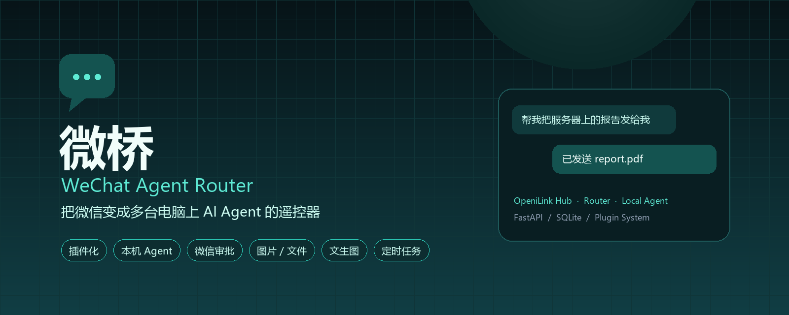
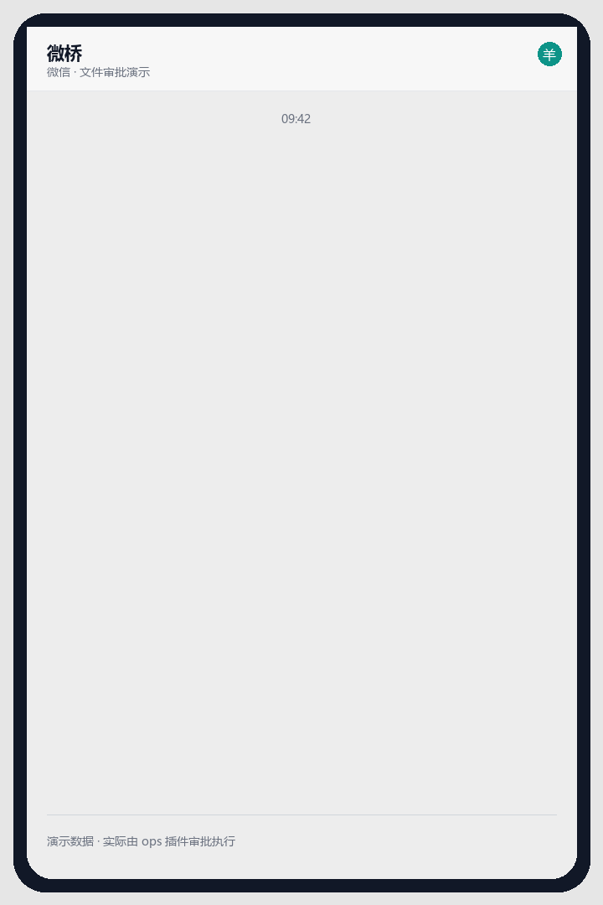
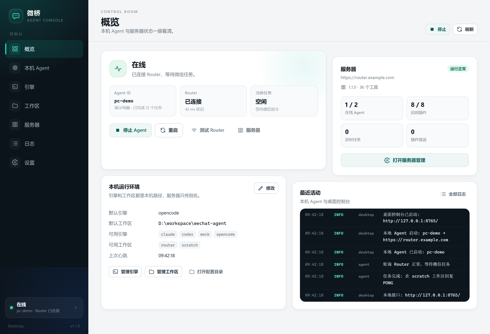
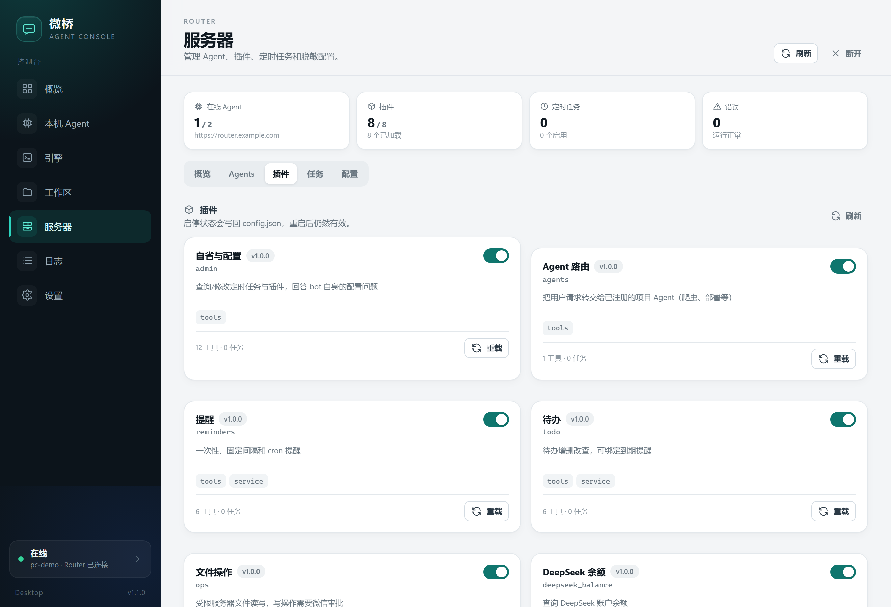
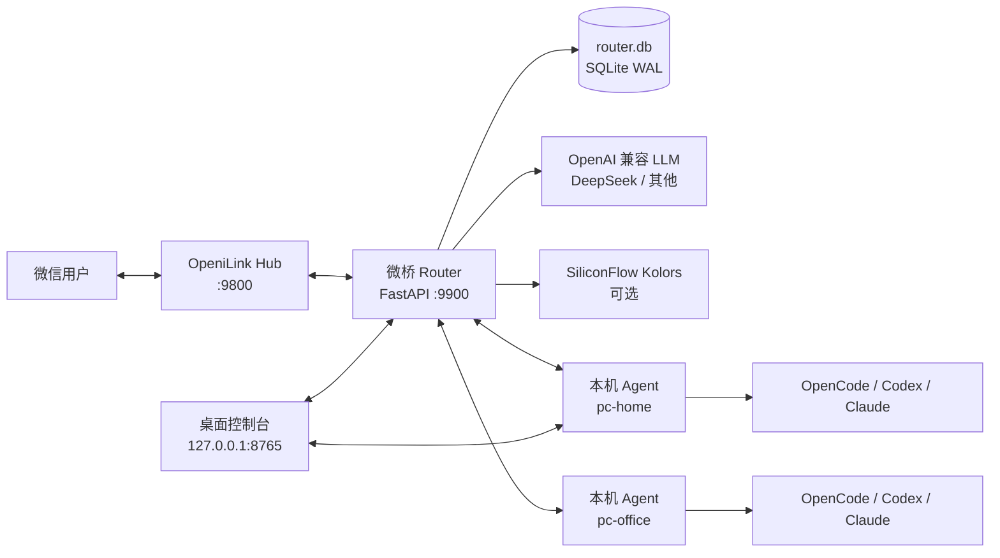
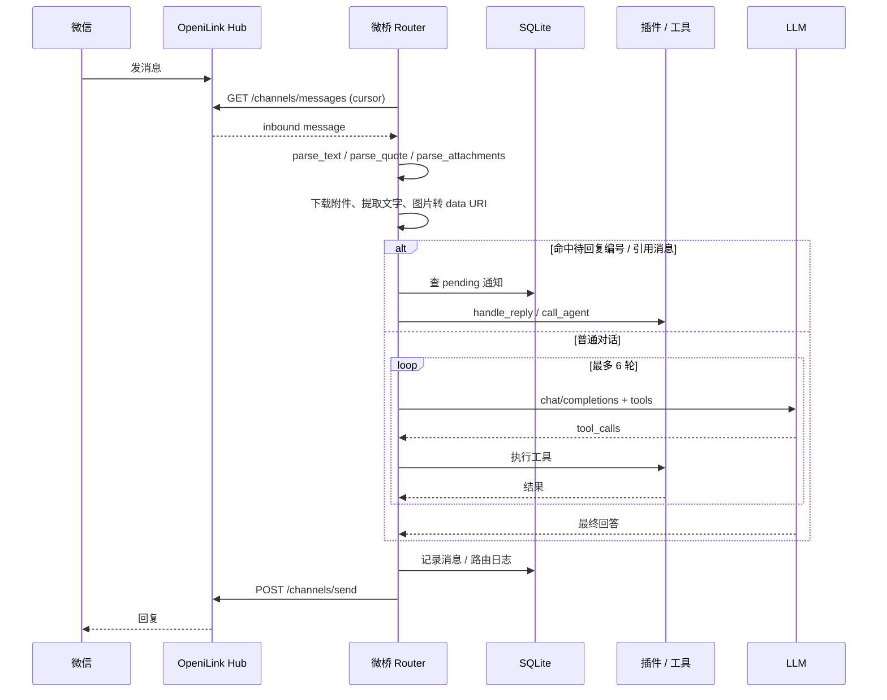
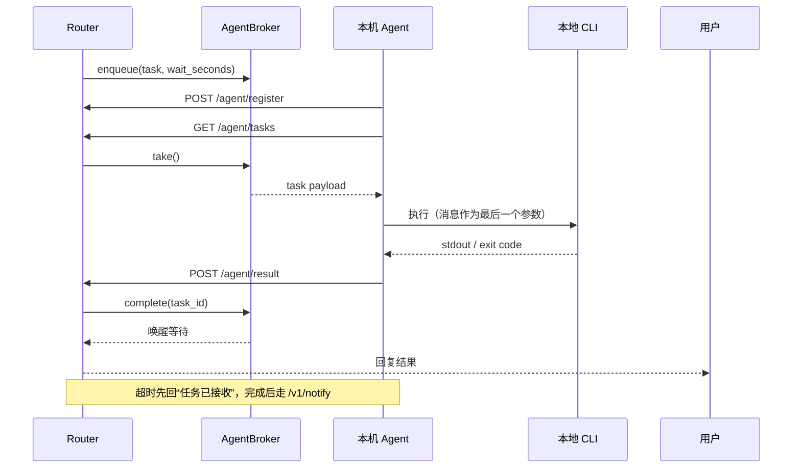
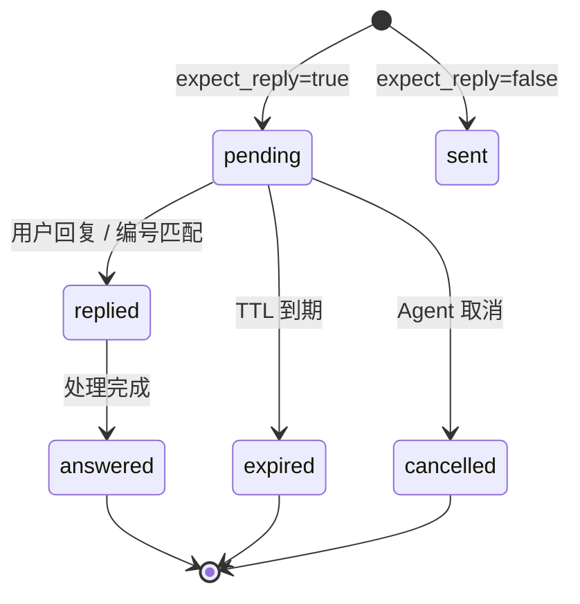

<div align="center">



# 微桥 · WeChat Agent Router

**把微信变成多台电脑上 AI Agent 的遥控器。**

[简体中文](README.md) · [English](README.en.md)

在微信里发一句话，让家里的 OpenCode、公司的 Codex、笔记本上的 Claude Code 干活；  
需要改文件时先发审批码，需要看图时直接发图，需要画图时直接生成。

[](https://www.python.org/)
[](https://fastapi.tiangolo.com/)
[](https://www.docker.com/)
[](https://github.com/Wing233/wechat-agent-router/pkgs/container/wechat-agent-router)
[](https://github.com/Wing233/wechat-agent-router/actions/workflows/ci.yml)
[](LICENSE)
[](#贡献)

[快速开始](#5-分钟跑起来) · [架构](#架构) · [插件](#插件系统) · [配置](#配置参考) · [API](#api-参考) · [安全](#安全模型)

</div>

<div align="center">
  
  <br />
  <sub>文件审批演示（演示数据）</sub>
</div>

---

## 目录

- [这是什么](#这是什么)
- [为什么做微桥](#为什么做微桥)
- [功能特性](#功能特性)
- [界面预览](#界面预览)
- [架构](#架构)
- [消息是怎么流转的](#消息是怎么流转的)
- [内置插件](#内置插件)
- [5 分钟跑起来](#5-分钟跑起来)
- [本机 Agent](#本机-agent)
- [桌面控制台](#桌面控制台)
- [配置参考](#配置参考)
- [API 参考](#api-参考)
- [插件开发](#插件开发)
- [安全模型](#安全模型)
- [运维与备份](#运维与备份)
- [常见问题](#常见问题)
- [Roadmap](#roadmap)
- [贡献](#贡献)
- [License](#license)
- [相关项目](#相关项目)
- [致谢](#致谢)

---

## 这是什么

微桥是一个**自托管的微信 AI Agent 网关**。

它不直接连接微信协议，而是通过 [OpeniLink Hub](https://github.com/openilink/openilink-hub) 收发微信消息；  
把所有 AI 路由、工具调用、审批、定时任务和状态都放在自己的 Router 里。

```text
微信  →  OpeniLink Hub  →  微桥 Router  →  LLM / 插件 / 本机 Agent
                              ↑
                     桌面控制台 / SQLite / 定时任务
```

它适合这些场景：

- 在微信里远程指挥家里的电脑跑 OpenCode / Codex / Claude Code
- 给微信 bot 加自己的 API、数据库、文件、提醒、待办
- 让 bot 读你发的图片、PDF、Word，并把结果发回微信
- 让 bot 调用文生图模型，直接把画好的图发到微信
- 需要“先审批再执行”的文件修改、插件安装
- 多台电脑、多个 Agent 统一管理

---

## 为什么做微桥

大部分“微信 AI bot”只能聊天；大部分“本地 Agent”只能在电脑前操作。

微桥把两边接起来：

| 痛点 | 微桥的做法 |
|---|---|
| 微信 bot 只能聊天，干不了活 | 通过 Agent 协议把任务派给本机 CLI |
| 家里电脑在 NAT 后面，没有公网 IP | 本机 Agent **主动出站轮询**，不开放端口 |
| 让 AI 改文件不放心 | 写/删/移动先发 4 位审批码，回复同意才执行 |
| 每个功能都要改主程序 | manifest + 权限 + 热加载的插件系统 |
| 多台电脑分不清 | 每台电脑一个 `agent_id`，微信里按描述或 `@id` 路由 |
| 图片、PDF 发过去看不懂 | 图片走视觉模型，PDF/DOCX 提取文字 |
| 想画图只能回 ASCII | 接 SiliconFlow Kolors，生成后直接发微信 |
| 定时任务、提醒散落在各处 | SQLite 持久化 job / reminder，重启不丢 |

---

## 功能特性

<table>
<tr>
<td width="50%" valign="top">

**微信与消息**

- 文本对话、引用回复、4 位审批码
- 图片理解（视觉模型）
- 文件读取：txt / md / csv / json / pdf / docx
- 图片、视频、文件出站发送
- 通知状态：pending / replied / answered / expired
- 发送失败自动进 outbox 重试

</td>
<td width="50%" valign="top">

**Agent 与工具**

- 本机 Agent 出站轮询（NAT 友好）
- 引擎：OpenCode / Codex / Claude Code / 任意命令
- 工作区别名 + 路径白名单
- 工具循环最多 6 轮，重复调用自动停止
- 插件热加载、启停、重载
- 文件操作审批 + 路径沙箱

</td>
</tr>
<tr>
<td valign="top">

**自动化**

- 一次性 / 固定间隔 / cron 提醒
- 定时任务持久化，错过窗口不补跑
- 待办清单，可绑定到期提醒
- 自定义数据插件（按插件 API 扩展）
- DeepSeek 余额查询

</td>
<td valign="top">

**生成与多模态**

- SiliconFlow Kolors 文生图
- 生成后自动发到微信
- 图片压缩前的大小/数量限制
- 附件保存到 `/workspace/inbox`
- 生成图保存到 `/workspace/generated`

</td>
</tr>
</table>

---

## 界面预览

桌面控制台是本机 Agent 的可视化配置界面，同时可以管理远程 Router。

### 概览



### 插件管理



> 截图使用演示数据，所有地址均为 `example.com`。

---

## 架构

### 部署拓扑



### 模块职责

| 模块 | 职责 |
|---|---|
| `app.py` | 组合根：配置、Hub 轮询、消息路由、LLM 工具循环、通知、定时任务、内部 API |
| `hub.py` | OpeniLink Hub 客户端：文本/文件发送、消息拉取、媒体下载、引用/附件解析 |
| `llm.py` | OpenAI 兼容 Chat Completions 客户端，支持 tools 和 vision |
| `store.py` | SQLite 状态层：通知、消息、outbox、凭据、提醒、插件审计 |
| `plugin_loader.py` | 插件 manifest 校验、权限、工具/任务/服务/密钥、热加载 |
| `registry.py` | 工具注册表与定时任务调度器 |
| `settings_service.py` | 运行时设置：任务间隔、插件启停、Agent CRUD、脱敏配置 |
| `agent_broker.py` | 出站轮询 Agent 的内存任务队列 |
| `attachments.py` | 入站附件下载、落盘、图片 data URI、PDF/DOCX 文本提取 |
| `imagegen.py` | SiliconFlow Kolors 文生图客户端 |
| `desktop/` | Windows 桌面控制台（PyWebView + 原生 HTML/CSS/JS） |
| `local-agent/` | 本机 Agent 运行时和 CLI 入口 |
| `plugins/` | 业务插件，每个目录一个 manifest + 实现 |

---

## 消息是怎么流转的

### 入站消息



### 本机 Agent 任务



### 通知与审批状态机



---

## 内置插件

| 插件 | 能力 | 主要工具 |
|---|---|---|
| `admin` | 自省与配置 | `list_jobs` `get_job` `set_job_interval` `set_job_enabled` `list_plugins` `config_get` `config_set` `api_balance` |
| `agents` | Agent 路由 | `send_to_agent` |
| `reminders` | 提醒 | `create_reminder` `list_reminders` `cancel_reminder` `pause_reminder` `resume_reminder` `snooze_reminder` |
| `todo` | 待办 | `todo_add` `todo_list` `todo_update` `todo_done` `todo_delete` `todo_clear_done` |
| `ops` | 文件操作 | `fs_list` `fs_read` `fs_write` `fs_replace` `fs_delete` `fs_move` |
| `leetcode` | 力扣（默认禁用） | `leetcode_stats` + Cookie 校验 + 登录页 |
| `deepseek_balance` | 余额查询 | `deepseek_balance` |
| `evolution` | 自我进化（默认禁用） | `propose_plugin` |
| `demo_time` | 时间演示 | `now` |
| `demo_weather` | 天气演示 | `now` |

核心工具：

| 工具 | 说明 |
|---|---|
| `send_media` | 把 `/workspace` 或 `/data/images` 下的图片、视频、文件发到微信 |
| `generate_image` | 调 SiliconFlow Kolors 生成图片并发送 |

> `leetcode` 和 `evolution` 在示例配置里默认禁用：一个涉及第三方平台 ToS，一个能生成并安装代码。请阅读 [安全模型](#安全模型) 后再启用。

---

## 5 分钟跑起来

### 前置条件

- 一台 Linux 服务器（或能跑 Docker 的 NAS / 云主机）
- 已部署 [OpeniLink Hub](https://github.com/openilink/openilink-hub)，并绑定微信
- 一个 OpenAI 兼容 LLM API Key（示例用 DeepSeek）
- 可选：SiliconFlow API Key（文生图）

### 1. 克隆并准备配置

```bash
git clone https://github.com/Wing233/wechat-agent-router.git
cd wechat-agent-router

cp config.example.json config.json
mkdir -p data workspace sandbox
```

生成必要密钥：

```bash
# Fernet key（力扣 Cookie 加密）
python -c "from cryptography.fernet import Fernet; print(Fernet.generate_key().decode())"

# 随机 token（service_token / login_token_secret / agent api_key）
python -c "import secrets; print(secrets.token_urlsafe(32))"

# Agent API Key
python -c "import secrets; print('pc_' + secrets.token_hex(20))"
```

编辑 `config.json`，至少填写：

```text
hub.base_url          OpeniLink Hub 地址
hub.channel_key       Hub 频道 key
hub.owner_id          你的微信 owner id
llm.api_key           LLM API Key
service_token         桌面端/内部 API 令牌
login_token_secret    登录链接签名密钥
credential_key        Fernet key
agents[].api_key      每个 Agent 的 key
```

> `public_base_url` 只有使用登录页/审批链接时才需要，建议填 `https://router.example.com`。

### 2. 启动 Router

```bash
docker compose up -d --build
```

检查：

```bash
curl http://127.0.0.1:9900/health
```

首次启动会在 `data/` 下创建 `router.db`。

### 3. 连接 OpeniLink Hub

Hub 和 Router 在同一台机器时，默认配置：

```json
"hub": {
  "base_url": "http://host.docker.internal:9800"
}
```

如果 Hub 也在 Docker 网络里，把 `hub.base_url` 改成 Hub 的服务名，例如：

```text
http://openilink-hub:9800
```

并把 Router 加入同一个 Docker network。

### 4. 启动本机 Agent

在本机 Windows 电脑上：

```powershell
cd <repo>
python -m pip install -r desktop\requirements.txt
python desktop\main.py
```

在桌面控制台里填写：

```text
Agent ID        pc-home
Router 地址     https://router.example.com
Agent Key       和 config.json 里 agents[].api_key 一致
默认引擎        opencode
默认工作区      router
```

保存后点「启动 Agent」。

也可以只用 CLI：

```bash
python local-agent/agent.py --config local-agent/config.json
```

### 5. 在微信里测试

先发一句最简单的：

```text
@pc-home 只回复 PONG，不要修改任何文件
```

或者：

```text
用 pc-home 的 codex 在 scratch 工作区只回复 PONG
```

看到 `PONG` 就说明整条链路通了。

---

## 本机 Agent

本机 Agent 是微桥的“手脚”。它不开放端口，而是主动向 Router 轮询任务，因此适合 NAT 后面的家用电脑。

### 工作方式

1. 每 `poll_seconds` 秒 `POST /agent/register` 上报在线状态、引擎和工作区
2. `GET /agent/tasks` 取任务；没有任务返回 `204`
3. 在指定工作区执行本地 CLI，把用户消息作为最后一个参数
4. `POST /agent/result` 回传 exit code 和输出
5. 超过 `wait_seconds` 时先回“任务已接收”，完成后通过 `/v1/notify` 补发结果

### 引擎配置

```json
{
  "engines": {
    "opencode": ["opencode", "run"],
    "codex": ["codex", "exec"],
    "claude": ["claude", "-p"],
    "mock": ["python", "-c", "print('PONG')"]
  }
}
```

- 命令的第一个元素是可执行文件，其余是参数
- 用户消息会追加到参数最后
- Windows 下通过 PowerShell 设置 UTF-8，超时会 `taskkill /F /T`
- 输出会清理 ANSI、尝试多种编码解码，最后截取末尾 6000 字符

### 工作区白名单

```json
{
  "workspaces": {
    "router": "D:\\workspace\\wechat-agent",
    "scratch": "D:\\workspace\\scratch"
  }
}
```

Router 只能传别名；真正的绝对路径只存在于本机配置里。  
即使 Router 被攻破，也不能让本机 Agent 在任意目录执行命令。

---

## 桌面控制台

> Windows 用户可以直接下载最新版：  
> <https://github.com/Wing233/wechat-agent-router/releases/latest/download/WeChatAgentDesktop.exe>  
> 这个地址始终指向最新 Release；安装说明见 [LYPH 下载页](https://github.com/Wing233/lyph)。

桌面控制台是 `local-agent` 的可视化壳，Windows 专用。

### 源码运行

```powershell
python -m pip install -r desktop\requirements.txt
python desktop\main.py
```

### 打包 exe

```powershell
powershell -ExecutionPolicy Bypass -File desktop\build.ps1
```

输出：

```text
desktop\dist\WeChatAgentDesktop.exe
```

### 能力

- 本机 Agent：身份、Key、Router 地址、默认引擎/工作区、启停、取消任务
- 引擎管理：OpenCode / Codex / Claude / 任意命令，支持试跑
- 工作区管理：路径白名单、目录选择
- 服务器管理：Agent、插件、定时任务、脱敏配置、余额
- 日志：本机 Agent、任务执行、配置修改
- 开机自启：无窗口后台运行

桌面控制台只监听 `127.0.0.1`，本地 API 需要随机 `X-Desktop-Token`；服务令牌用 Windows DPAPI 加密保存。

---

## 配置参考

完整示例见 [`config.example.json`](config.example.json)。

### 顶层

| 字段 | 说明 |
|---|---|
| `hub.base_url` | OpeniLink Hub 地址 |
| `hub.channel_key` | Hub 频道 key |
| `hub.owner_id` | 你的微信 owner id |
| `db` | Router SQLite 路径，默认 `/data/router.db` |
| `data_dir` | 图片等运行数据目录 |
| `public_base_url` | 公网地址，用于登录链接 |
| `poll_interval` | Hub 轮询间隔（秒） |
| `initial_last_id` | 首次拉取游标 |
| `credential_key` | Fernet key，加密力扣 Cookie |
| `login_token_secret` | 登录链接 HMAC 密钥 |
| `service_token` | 内部 API / 桌面端令牌 |
| `agent_wait_seconds` | Agent 同步等待秒数，默认 60 |

### LLM

```json
"llm": {
  "base_url": "https://api.deepseek.com",
  "api_key": "REPLACE",
  "model": "deepseek-chat",
  "system_prompt": ""
}
```

任何 OpenAI 兼容的 `/chat/completions` 都可以；支持 tools 的模型才能用完整工具链。  
如果模型支持图片输入，入站图片可以直接理解。

### 附件

```json
"attachments": {
  "enabled": true,
  "dir": "/workspace/inbox",
  "max_files": 3,
  "max_image_mb": 4,
  "max_file_mb": 10,
  "text_chars": 20000
}
```

- 图片：转 base64 data URI 给视觉模型
- 文本类：UTF-8 / GB18030 / UTF-16 自动解码
- PDF：`pypdf` 提取
- DOCX：`python-docx` 提取
- 视频/语音：保存，但当前不解析内容
- XLSX：暂不支持

### 文生图

```json
"image": {
  "enabled": true,
  "base_url": "https://api.siliconflow.cn/v1",
  "api_key": "REPLACE",
  "model": "Kwai-Kolors/Kolors",
  "size": "1024x1024",
  "steps": 20,
  "guidance": 7.5,
  "dir": "/workspace/generated"
}
```

不开启就设 `"enabled": false`。生成结果会保存到 `dir`，然后通过 `send_media` 发到微信。

### Agents

```json
"agents": [
  {
    "id": "pc-home",
    "name": "家里电脑",
    "description": "Windows 台式机，可用 opencode/codex，默认工作区 router",
    "transport": "poll",
    "callback_url": "",
    "callback_secret": "",
    "api_key": "pc_xxx"
  }
]
```

- `transport: "poll"`：本机 Agent 主动轮询（推荐）
- `transport: "http"`：Router 回调 `callback_url`，用 HMAC 签名
- `description` 会出现在 system prompt 里，LLM 按描述选择 Agent

### 插件

```json
"plugins": {},
"disabled_plugins": ["evolution", "leetcode"]
```

`plugins.<id>` 是插件自己的配置；`disabled_plugins` 控制启动时是否加载。

---

## API 参考

### Agent 侧

认证：`X-API-Key: <agents[].api_key>` 或 `Authorization: Bearer ...`

| 方法 | 路径 | 说明 |
|---|---|---|
| POST | `/v1/notify` | 主动通知；支持 `text`、`image_base64`、`expect_reply`、`ttl_seconds`、`meta` |
| GET | `/v1/notify/{id}` | 查询通知状态和回复 |
| POST | `/v1/notify/{id}/cancel` | 取消 pending 通知 |

### 本机 Agent

认证：`X-Agent-Key: <agents[].api_key>`

| 方法 | 路径 | 说明 |
|---|---|---|
| POST | `/agent/register` | 注册/心跳，上报 engines/workspaces |
| GET | `/agent/tasks?agent_id=...` | 取任务，无任务 `204` |
| POST | `/agent/result` | 回传 `task_id`、`ok`、`text` |

### 内部 / 桌面端

认证：`X-Service-Token: <service_token>`

| 方法 | 路径 | 说明 |
|---|---|---|
| GET | `/health` | 健康检查 |
| POST | `/internal/ask` | 直接问 Router |
| GET | `/internal/settings/overview` | 服务器总览 |
| PATCH | `/internal/settings/config` | 修改脱敏配置 |
| PATCH | `/internal/settings/jobs/{id}` | 修改任务间隔/窗口/启停 |
| POST | `/internal/settings/jobs/{id}/run` | 立即运行任务 |
| POST | `/internal/plugins/{id}/reload` | 重载插件 |
| POST | `/internal/plugins/{id}/enable` | 启用插件 |
| POST | `/internal/plugins/{id}/disable` | 停用插件 |
| GET | `/internal/settings/logs` | 最近日志 |

> 不要把 `9900` 直接暴露到公网；桌面端和内部 API 都应走内网或反向代理 + TLS。

---

## 插件开发

插件是微桥的扩展单元：一个目录，一个 `manifest.json`，一个 `plugin.py`。

### manifest

```json
{
  "id": "hello",
  "name": "Hello",
  "version": "1.0.0",
  "api_version": "1",
  "entry": "plugin.py",
  "capabilities": ["tools"],
  "permissions": ["send:wechat"],
  "secrets": [],
  "description": "最小示例插件"
}
```

### 实现

```python
def apply(ctx) -> None:
    def hello(args: dict) -> dict:
        name = str(args.get("name") or "世界")
        return {"message": f"你好，{name}"}

    ctx.tools.register(
        "hello",
        "向用户问好",
        {
            "type": "object",
            "properties": {"name": {"type": "string"}},
        },
        hello,
    )
```

注册后的工具名是 `hello__hello`，同时保留别名 `hello`。

### 权限

| 资源 / 能力 | 需要 permission |
|---|---|
| `ctx.resource("store")` | `db:router` |
| `ctx.resource("agents")` | `agent:read` |
| `ctx.resource("call_agent")` | `agent:call` |
| `ctx.resource("settings")` | `admin` |
| `ctx.send()` | `send:wechat` |
| `ctx.http_request()` | `net:<hostname>` |
| `ctx.secret(name)` | manifest 里声明 `secrets` |

### 生命周期

- `apply(ctx)`：加载时调用
- `ctx.on_unload(fn)`：卸载时清理
- `ctx.provide(name, service)`：暴露服务给其他插件
- 支持 `reload` / `enable` / `disable`，状态写回 `config.json`

### 调试

```bash
# 看插件是否加载
curl http://127.0.0.1:9900/health

# 看插件错误
curl -H "X-Service-Token: $SERVICE_TOKEN" \
  http://127.0.0.1:9900/internal/settings/overview
```

---

## 安全模型

微桥的目标是“方便”，不是“零信任”。请按下面的边界部署。

### 令牌

| 令牌 | 权限 | 建议 |
|---|---|---|
| `hub.channel_key` | 收发该频道消息 | 只给 Router |
| `service_token` | 管理配置、插件、任务 | 不写进前端、不进 git |
| `agents[].api_key` | 冒充某个 Agent | 每台电脑独立，定期轮换 |
| `login_token_secret` | 签发登录链接 | 随机 32 字节以上 |
| `credential_key` | 加密力扣 Cookie | 备份好，丢了要重新登录 |

### 文件操作

- 允许根目录：`/app`、`/app/plugins`、`/workspace`
- 禁止 `.git`、`.env`、`config.json`、`data`、`node_modules` 等
- 单文件读写 64 KB
- 写/删/移动必须微信审批
- 审批码 4 位，TTL 默认 15 分钟

### 本机 Agent

- 不开放入站端口，只做出站轮询
- 只能在配置的工作区里执行
- 引擎命令由本机配置决定，Router 不能传任意命令
- 任务超时会终止进程树

### 外部服务

- 文生图、LLM、Hub 都是外部依赖；Key 只存服务端
- `leetcode` 插件会保存 `LEETCODE_SESSION` Cookie，使用前请确认平台 ToS
- `evolution` 插件能生成并安装代码，默认禁用；启用前请确认你信任模型输出

### 生产建议

```text
1. 不要把 9900 直接暴露公网
2. 用 Nginx/Caddy 做 HTTPS 和访问控制
3. service_token / agent_key 定期轮换
4. 备份 data/router.db 和 config.json
5. 容器的 plugins/workspace 只挂载必要目录
6. 给 Docker 加 no-new-privileges、只读根文件系统（按需）
```

---

## 运维与备份

### 日志

```bash
docker logs -f wechat-agent-router
```

桌面端日志在 `desktop/.runtime/desktop.log`（源码运行）或 `%LOCALAPPDATA%\WeChatAgentDesktop\desktop.log`（exe）。

### 备份

```bash
# SQLite 在线备份
sqlite3 data/router.db ".backup 'backup/router-$(date +%F).db'"

# 配置和生成的媒体
tar czf backup/config-$(date +%F).tar.gz config.json workspace/
```

### 升级

```bash
git pull
docker compose up -d --build
```

数据库自动迁移（`store.init()` 只做 `CREATE TABLE IF NOT EXISTS`）。升级前建议备份。

### 健康检查

```bash
curl -s http://127.0.0.1:9900/health | jq
```

返回 Agent、插件、工具、任务、凭据和 Broker 状态。

---

## 常见问题

<details>
<summary><strong>Hub 返回 401 / 403</strong></summary>

检查 `hub.channel_key` 是否是该频道的 key，`hub.owner_id` 是否是收到消息的 owner id。  
Hub 的频道 key 在 Hub 后台的频道设置里。

</details>

<details>
<summary><strong>Hub 返回 409 / 503</strong></summary>

通常表示微信 24 小时窗口过期或 Bot 不在线。  
到 Hub 后台看 Bot 状态，按提示在微信里回一条消息续期。

</details>

<details>
<summary><strong>本机 Agent 显示离线</strong></summary>

1. 确认 `local-agent/config.json` 的 `router` 地址能从本机访问
2. 确认 `agent_id` 和 `api_key` 与 Router `config.json` 的 `agents[]` 一致
3. 看桌面端日志或 `local-agent/agent.log`
4. 用 `curl <router>/health` 确认 Router 正常

</details>

<details>
<summary><strong>LLM 一直调用工具 / 重复调用</strong></summary>

Router 有 6 轮上限和重复调用检测。  
如果模型仍然循环，检查工具返回是否过大（会被截断到 16000 字符），或换一个工具调用能力更强的模型。

</details>

<details>
<summary><strong>图片能收到但看不懂</strong></summary>

确认 `attachments.enabled=true`，并且 LLM 模型支持图片输入（vision）。  
如果模型只支持文本，图片会走文本兜底或报错。

</details>

<details>
<summary><strong>PDF / DOCX 读不出来</strong></summary>

需要安装 `pypdf` 和 `python-docx`；Docker 镜像已经包含。  
扫描版 PDF 没有文本层，需要 OCR，当前不内置。

</details>

<details>
<summary><strong>文生图失败</strong></summary>

检查 `image.enabled`、`image.api_key`、`image.base_url` 和模型名。  
SiliconFlow 的 Kolors 返回 `images[0].url`；如果换了供应商，需要确认返回格式兼容。

</details>

<details>
<summary><strong>LeetCode Cookie 一直过期</strong></summary>

在微信里发“力扣登录”，按链接重新绑定 `LEETCODE_SESSION` 和 `csrftoken`。  
Cookie 会加密存进 `credentials` 表，不会写进日志。

</details>

---

## Roadmap

- [ ] 视频内容分析（ffmpeg 抽帧 + 视觉模型 / ASR）
- [ ] XLSX 表格读取
- [ ] 更多内置 Agent 适配器（Aider、Continue、Gemini CLI）
- [ ] Web 管理台（不依赖桌面端）
- [ ] 插件市场 / 一键安装
- [ ] OpenTelemetry / Prometheus 指标
- [ ] 更完整的集成测试与端到端测试

---

## 贡献

欢迎 Issue、PR、插件和文档改进。

```bash
git clone https://github.com/Wing233/wechat-agent-router.git
cd wechat-agent-router
python -m venv .venv
. .venv/bin/activate
pip install -r requirements.txt -r requirements-dev.txt
pytest
```

提交前请确认：

- 不提交 `config.json`、`data/`、`workspace/`、日志和密钥
- 新插件带 `manifest.json` 和最小说明
- 改动涉及权限/文件/网络时，在 PR 描述里写清安全边界
- 不把真实服务器地址、微信 ID、Cookie、API Key 写进代码或截图

开发文档见 [`docs/`](docs/)。

---

## License

[MIT](LICENSE) © 2026 Wing233

---

## 相关项目

- [LYPH](https://github.com/Wing233/lyph) — 可自托管的个人站点 + AI Agent 对话 + 桌面截图日报 + PWA 采集台

---

## 致谢

- [OpeniLink Hub](https://github.com/openilink/openilink-hub) — 微信通道与消息管理- [FastAPI](https://fastapi.tiangolo.com/) / [Uvicorn](https://www.uvicorn.org/) — HTTP 服务
- [APScheduler](https://apscheduler.readthedocs.io/) — 定时任务
- [cryptography](https://cryptography.io/) — Fernet 加密
- [pypdf](https://pypdf.readthedocs.io/) / [python-docx](https://python-docx.readthedocs.io/) — 文档解析
- [PyWebView](https://pywebview.flowrl.com/) / [PyInstaller](https://pyinstaller.org/) — 桌面端
- [DeepSeek](https://www.deepseek.com/) / [SiliconFlow](https://www.siliconflow.cn/) — LLM 与文生图
- [Feather Icons](https://feathericons.com/) — 桌面端图标风格

> 微桥是独立项目，与微信、OpeniLink、DeepSeek、SiliconFlow 均无官方关联。使用前请遵守各平台的服务条款。
